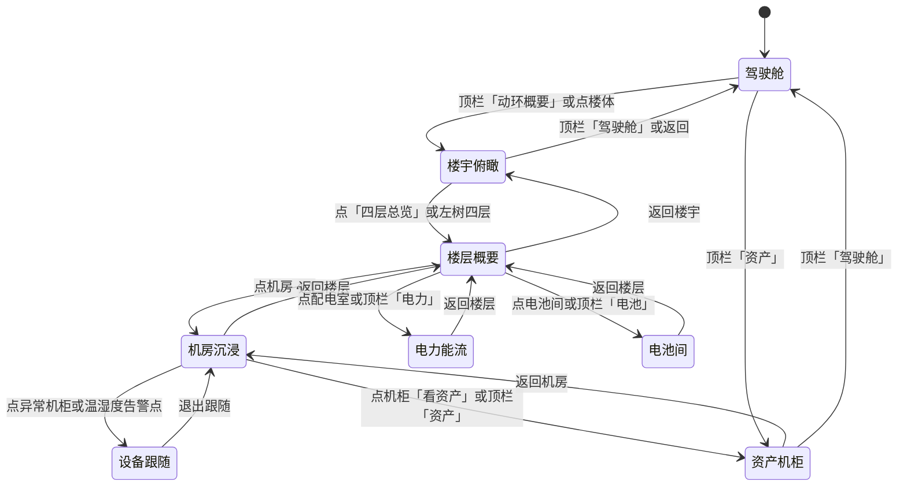

# ISM 动环演示大屏设计方案

演示对象：并行科技内蒙古新型算力基地 3 号楼。参照物是瑞点 GS 已经画出并实现的动环画面（`docs/动环软件画面截图/动环软件画面截图/`）。周三要给甲方看的，是同一座楼的信息，用更清楚的镜头和更克制的光效讲出来。

本方案只定义演示壳。不改组态运行链路，不改密码链路，不改 `vue.config.js` 代理。

## 1. 目标与演示口径

周三（2026-10-21）面对的是甲方领导和业务负责人，不是运维值班员。他们要在大约十分钟里看懂：3 号楼从楼宇到楼层、机房、单柜是同一套空间，环境和电力、电池、资产能沿着这条空间往下看。成功标准是：六屏都能从顶栏进入并原路返回；至少有一次「楼宇飞入楼层再飞入机房」；至少有一处异常被点亮并被镜头跟上；资产不只是表格，要能看到机柜 U 位和一次上架落入。数据用可替换的演示数据源，口径对齐参考画面里的 3 号楼（PUE、楼层机房编号、配电与电池间），当场说明是演示数据，不冒充现场实时协议。

## 2. 需求归纳

| 用户原话要求 | 设计决策 |
|---|---|
| 参考并行科技内蒙古新型算力基地 3 号楼、瑞点 GS 已实现的动环画面，要比它更好看 | 信息对象沿用 3 号楼：驾驶舱、楼宇、四层概要、机房平面、电力、UPS 与电池、资产台账与上下架。视觉和镜头重做，不照搬瑞点 GS 的静态贴图和密集二次系统图 |
| 各种视图俯瞰；镜头跟随设备或路径；沉浸式进入，从楼宇飞入楼层、机房、单柜或单机 | 一条镜头状态机。俯瞰、楼层、机房、跟随是四级空间，电力、电池、资产是从楼层或机房进入的专题镜头，都能返回上一级 |
| 可以借鉴游戏镜头、动画、层次、光效，更高科技、更科幻、更有科学感；仍是专业 SCADA，不是卡通，不是霸气 HUD 满屏 | 见第 3 节。骨架是读数、状态、空间位置；游戏语言只用在镜头运动、层次和少量光效 |
| 周三给甲方演示，要炫酷，抓住领导眼球，触发兴奋点 | 兴奋点放在三次镜头：飞入机房、异常单体点亮、设备上架落入 U 位。其余界面保持安静，让这三次被看见 |
| 资产设备管理也要有可演示效果，不只做环境和电力 | 第六屏单独做机柜 U 位沉浸、台账侧栏、一次上架动画。资产报警只取一条「借用到期」作为侧栏状态，不进审批 |
| 演示不做全部审批流程 | 参考图里的入库、领用、借用归还、调拨、维修、报废、盘点、待审批、已审批、个人办公，周三都不做、不讲 |
| 挂到现有菜单；WIRED 目前只接了少数页，其余是 SkeletonPage | 在「可视化」下新增「动环演示大屏」并接入 WIRED。已接通的工作台、实时总览、告警、平面组态、2.5D 导航保持原样 |
| 不破坏已验证组态链路 | 演示壳不进入 `VizDisplayHost` 的组态 iframe，不改 ISMBase、ViewRealTable、ViewSvgText，不改 `actions.js` 的 `parseRawPageLayerFields`、`applyNavContextToPageConfig` |
| 演示数据可交替 | 页面只读一个演示数据源接口。默认 JSON 夹具；以后可换成另一份夹具或只读 API，页面不改 |
| 不要改密码链路，不要改 vue.config.js 代理 | 方案与实现范围都不包含登录、MD5、bcrypt、`/api` 代理 |

参考图与信息架构核对：

| 图 | 画面里实际有什么 | 周三怎么用 |
|---|---|---|
| `综合首页.png` | 标题为 3#楼综合管理系统；顶栏多模块；中央楼宇；PUE 1.15、WUE；左电力与室外温湿度、机房 IT 功率；右能耗与制冷功率；底月用电 | 驾驶舱的信息清单。顶栏收成六屏，不把视频、门禁、拓扑放进演示导航 |
| `概要视图-1.png` | 楼宇外观，邻楼虚化，右侧一层至四层总览标签，左树为楼层 | 楼宇俯瞰。点楼层标签触发飞入 |
| `概要视图-2.png` | 四层等轴概要：机房绿色、配电与电池偏蓝紫，底栏是温湿度、漏水、空调、电量仪、蓄电池、UPS 等子系统 | 楼层概要。底栏在演示里收成「环境 / 电力 / 电池」三个入口，避免十几个图标抢镜头 |
| `环境总览.png` | 四层正交平面，机房 4-1 至 4-4、配电室、电池间，机柜编号与大量温湿度标签 | 机房沉浸。默认只显示房间名和少量关键标签，点房间或机柜再展开读数 |
| `电力监控.png` | 1-1 配电室低压系统图，母线、馈线、断路器与电压电流功率密密麻麻 | 不原样搬上大屏。改成市电→整流/逆变→IT 的能流，关键电气量放在玻璃卡片 |
| `电池监控.png` | UPS1 主路、旁路、整流、逆变、电池、输出，以及底部几十个状态点 | UPS 能流用这张图的拓扑，底部状态收成「市电供电 / 电池浮充 / 通讯正常」三枚，其余进悬停 |
| `电池监控-2.png` | 一至四层电池间，绿色单体块，电压电流与 `4-1A1-UPS1-BAT` 一类编号 | 电池间矩阵。绝大多数保持稳态绿，预置 1 块异常可点亮 |
| `资产台账.jpg` | 资产管理下的台账表：名称、状态、位置「3号楼@2层@机房2-1」、RFID、使用人；左树极深 | 台账侧栏只留名称、状态、位置、U 位。位置字段就是镜头跳转键 |
| `资产上下架.jpg` | 上架单详情：库存设备、审核中、3号楼@2层@机房2-1、机柜 A01、U 位 2，底部是审批进度 | 只保留「设备落入指定 U 位」这一下动画。单号、审核中、重提交流程不演示 |
| `资产报警.jpg` | 借用到期 / 维保到期 / 报废 / RFID 等报警表，位置同样是楼@层@房间 | 侧栏可出现一条借用到期，点它飞到对应机柜。不做处理、导出、审批 |

同目录其余资产图（入库、领用、借用归还、调拨、维修、报废、盘点、待审批、已审批、个人办公、提醒）已确认是后台流程，不进入演示信息架构。

## 3. 设计原则

专业 SCADA 是骨架，游戏镜头和光效是皮。领导感到「这是一套能看楼、看电、看设备的系统」，而不是「这是一个游戏」。

借什么：

- 借镜头。俯瞰、缓推、落入、跟随，用 0.9 到 1.4 秒的缓动把空间层级演出来。游戏里这一下叫「进入场景」，这里叫「进入这间机房」。
- 借层次。远景楼体、中景房间色块、近景机柜与读数分成三层，同一时刻只让一层最亮。
- 借光效。玻璃面板一条细亮边，正常态冷青，异常态琥珀或玫红。光只标状态，不铺满屏幕。
- 借科学感。能流沿真实功率方向走，冷热通道用色温区分，数字等宽、单位始终可见。

不借什么：

- 不借卡通比例、角色、Q 版机柜、夸张弹跳。
- 不借满屏 HUD：准星、血条、雷达扫描铺底、四角括号把每块面板框死、常驻粒子雨、屏幕震动。
- 不借战斗提示音和「WARNING」全屏红闪。异常是一处被点亮的设备，不是全屏警报剧。
- 不借无意义的持续自转。楼宇可极慢环视一圈后停住，等待点击。

节奏：慢、少、有目的。同时在动的东西不超过两处（例如能流虚线 + 一颗异常呼吸灯）。面板入场 240 毫秒，不级联乱飞。

## 4. 视觉语言

主分辨率 1920×1080，布局用弹性栅格，2560×1080 或 2560×1440 时两侧留出呼吸，中央舞台放大，不把 1080 画布简单拉宽导致字糊。

色板（实现时直接用这些值）：

| 角色 | 色值 | 用途 |
|---|---|---|
| 背景底 | `#071018` | 页面底 |
| 舞台空域 | `#0E1C2E` | 楼宇与机房背后的空间 |
| 玻璃面板 | `rgba(10, 24, 40, 0.72)` | 左右指标、台账侧栏 |
| 玻璃内高光 | `rgba(255, 255, 255, 0.06)` | 面板顶部 1px |
| 描边 | `rgba(120, 196, 232, 0.45)` | 面板与房间常态 |
| 主文字 | `#E7F2FA` | 标题与当前值 |
| 次文字 | `#8EADC4` | 单位、路径、说明 |
| 正常 | `#3DDC97` | 稳态、在用 |
| 关注 | `#F5A524` | 预警、借用到期、审核外的待关注 |
| 异常 | `#FF5C7A` | 越限、离线、点亮的那一块 |
| 能流 | `#5CC8FF` | 电力、UPS 主路 |
| 旁路/未走通 | `#3A5168` | 旁路、无电流支路 |
| 冷通道 | `#7ED0E8` | 机房通道暗示，低饱和 |
| 热通道 | `#C47A5A` | 只在机柜列间隙用细线，不铺红 |

字体：界面用 `"PingFang SC", "Microsoft YaHei", sans-serif`。数字用 `tabular-nums`，优先 `"DIN Alternate", "Tabular Nums", sans-serif`。不新增在线字体。标题 20px，当前值 28–36px，辅助 13–14px。1920 下侧栏正文不小于 14px。

面板：圆角 8px，模糊只做在面板上（`backdrop-filter: blur(10px)`），舞台本身不整屏模糊。发光边用 1px 描边加 8px 外发光，透明度随状态变，不做呼吸全屏。

动效节奏：

| 动作 | 时长 | 曲线 | 约束 |
|---|---|---|---|
| 镜头飞入 / 返回 | 900–1400ms | cubic-bezier(0.4, 0.0, 0.2, 1) | 飞的时候面板先淡出，落地后再淡入，避免字在运动中抖动 |
| 面板显隐 | 240ms | ease | 不同时超过四块面板入场 |
| 能流虚线 | 2.4s 循环 | linear | 只在电力、UPS 主路 |
| 异常呼吸 | 1.6s | ease-in-out | 全屏同时只允许一个主异常在呼吸 |
| 上架落入 | 1.2s | ease-out | 只播一次，播完停在 U 位 |

## 5. 信息架构与镜头

空间主键与参考台账一致：`楼 → 层 → 房间 → 机柜 → U 位 / 设备`。电力与电池挂在房间类型上（配电室、电池间），不是另一棵无关的树。

顶栏只有六项：驾驶舱、动环概要、环境、电力、电池、资产。左侧在动环概要里保留 1–4 层；进入四层后列出机房 4-1～4-4、配电室、电池间。更深的子系统树不展开。



| 镜头 | 触发 | 看到什么 | 返回 |
|---|---|---|---|
| 驾驶舱 | 进入演示壳默认；顶栏「驾驶舱」 | 3 号楼远景居中，PUE、电力、温湿度、四间机房功率、能耗构成。楼体可点 | 无上级。顶栏去其他五屏 |
| 楼宇俯瞰 | 顶栏「动环概要」或在驾驶舱点楼体 | 镜头推近到楼体，邻楼压暗。一层至四层总览标签贴在楼侧。左树只到层 | 顶栏或「返回」回驾驶舱 |
| 楼层概要 | 点「四层总览」 | 镜头从楼侧落入四层等轴平面。机房、配电室、电池间以不同描边区分，房间名清楚，设备还是体块 | 「返回楼宇」 |
| 机房沉浸 | 在楼层概要点机房 4-1 | 镜头落入该机房，冷热通道可读，列头与少量传感器亮着。其余房间留在画面边缘变暗 | 「返回楼层」 |
| 设备跟随 | 在机房点一台预置异常柜，或点一枚越限温湿度 | 镜头停在该柜斜上方，侧栏给出柜名、温度、功率。路径文字写成「3号楼 / 4层 / 机房4-1 / 柜」 | 「退出跟随」回机房沉浸 |
| 电力能流 | 楼层点配电室，或顶栏「电力」 | 离开密集一次图。三条路径：主路点亮流动，旁路灰掉。卡片给电压、电流、功率、负载率 | 「返回楼层」。若从顶栏直达，返回仍回进入前的楼层镜头；默认演示脚本从四层进来 |
| 电池间 | 楼层点电池间，或顶栏「电池」 | 上半是 UPS 能流（主路、旁路、电池），下半是电池间矩阵。一块预置异常单体亮琥珀 | 「返回楼层」 |
| 资产机柜 | 顶栏「资产」，或机房里点「看资产」 | 镜头落到单柜正面，U 位格子可见。右侧台账。点一条位置记录会飞到对应柜 | 「返回机房」或顶栏回驾驶舱 |

跟随的对象周三只做两种：一台机柜、一条上架路径（设备从侧栏滑入指定 U 位）。不做人员漫游、不做巡检轨迹回放。

## 6. 演示画面清单

### 6.1 驾驶舱综合首页

- 对应参考图：`综合首页.png`
- 布局：上为标题「3号楼 · 动环演示」与六项顶栏；中为楼宇舞台；左为进线功率与负载、室外温湿度、机房 IT 功率；右为总电能、总功率、IT / 辅助 / 其他占比；底为一条月用电，默认停在「总用电」，IT 与用水做成两个切换，不自动轮播。
- 关键交互：点楼体进入楼宇俯瞰。PUE 用参考口径 1.15，旁边注明「演示数据」。WUE 若参考图为 0，演示里保留数字并标「演示」，不解释成真实节水成绩。
- 比参考图好在哪：楼是可进入的镜头起点，不是一张贴在仪表中间的效果图。左右面板压到玻璃层，不和楼抢同一平面。
- 演示台词：这是 3 号楼的驾驶舱，PUE 和各机房功率从这里一眼能看到，点楼就能进去。

### 6.2 动环概要（楼宇加楼层）

- 对应参考图：`概要视图-1.png`、`概要视图-2.png`
- 布局：先是楼宇俯瞰加楼层标签；落入后是四层色块平面，左树展开四层房间。底栏只留环境、电力、电池三个入口。
- 关键交互：点「四层总览」播放飞入；飞入结束后才能点房间。左树点「四层」与点标签是同一条过渡。
- 比参考图好在哪：参考图的楼和楼层是两张切开的页面。这里是一次连续镜头。邻楼压暗用透明度，不用另一套写实贴图。
- 演示台词：从楼外落到四层，机房、配电、电池间还在同一张平面上。

### 6.3 环境总览（机房平面沉浸）

- 对应参考图：`环境总览.png`
- 布局：舞台是机房 4-1 的 2.5D 列柜，通道可辨。右侧玻璃栏只放这间房的最高温度、最低温度、一条漏水状态、空调运行台数。传感器不全铺在地上。
- 关键交互：点预置的一台偏热机柜，镜头跟随，标签展开该点温湿度。再点空白处退出跟随。
- 比参考图好在哪：参考图是正交蓝图加满屏绿标，领导看不清「哪一间、哪一柜」。演示默认疏、点击才密。
- 演示台词：进到机房 4-1 之后，异常柜会被镜头跟上，不用在整张平面里找绿格子。

### 6.4 电力监控（能流，不搬二次系统图）

- 对应参考图：`电力监控.png` 只取「这间配电室有主路和馈线、有电压电流功率」这一层事实，不取图面。
- 布局：中央一条横向能流：市电 → UPS 主路 → 机房 IT。旁路以灰线画在下方，电流为 0。左侧三块卡片：线电压、相电流、有功功率与负载率。不画断路器矩阵，不写长串回路号。
- 关键交互：能流沿主路循环流动。点击「旁路」只把灰线说明展开一句「当前未走旁路」，不切换成二次图。
- 比参考图好在哪：参考图是给配电专业值班看的密图。演示回答的是「电从哪来、现在走哪条、负载大概多少」。
- 演示台词：电力这里不铺二次接线图，只让领导看见电正沿主路送进机房。

### 6.5 电池监控（UPS 能流加电池间矩阵）

- 对应参考图：`电池监控.png`、`电池监控-2.png`
- 布局：上半 UPS，主路亮、旁路灰，电池支路用细线连到矩阵；读数保留电池电压、电流、后备时间、剩余容量、输出负载。下半按「4-1 电池间」排一组单体，常态绿，其中一块（演示数据写死）为关注色，显示偏低电压。底部不再铺 48 个「是/否」。
- 关键交互：点那块异常单体，它呼吸点亮，侧栏写出编号（沿用 `楼-房间-UPS-BAT` 这种参考编号风格）和电压。再点 UPS 主路，镜头轻移回能流，矩阵保持可见。
- 比参考图好在哪：参考图要么是 UPS 原理加参数墙，要么是整楼绿色方块铺满。演示把「电怎么走」和「哪一节不正常」放在同一屏，异常只有一处。
- 演示台词：电池不是一整面绿灯，这一节偏离了，点它就能定位到哪一组。

### 6.6 资产演示（U 位沉浸、台账侧栏、一次上架）

- 对应参考图：`资产台账.jpg`、`资产上下架.jpg`、`资产报警.jpg`
- 布局：中央单柜正面，42U 格子，已在架设备为实块，空 U 为暗格。右侧台账列：设备名称、状态、位置、柜与 U 位。顶部一个按钮「演示上架」。侧栏可有一条状态为「借用到期」的记录。
- 关键交互：点台账某一行，镜头切到其位置所在柜（演示数据用 3 号楼 / 2 层 / 机房 2-1 / 柜 A01，与参考台账路径一致）。点「演示上架」后，一台设备沿柜前落入 U2，落入后台账该行状态变为「在用」，U2 亮正常色。不出现审批时间轴、不出现重提。点「借用到期」那一行，只高亮对应柜，不打开报警处理表。
- 比参考图好在哪：参考资产是深菜单加表格加审批弹窗。演示把位置字符串变成柜里的一格，上架是看得见的动作。
- 演示台词：资产和动环是同一栋楼，这台设备上到 A01 的 U2，位置马上能在柜子上看到。

## 7. 演示脚本（约 10 分钟）

讲的时候人站在画面左侧，鼠标只做脚本里的点击。每步落地后再开口，不在飞镜头时念数字。

| 时间 | 点哪里 | 镜头 | 说什么 |
|---|---|---|---|
| 0:00–0:40 | 已打开演示壳，停在驾驶舱 | 楼宇远景，面板静止 | 今天看的是内蒙古新型算力基地 3 号楼。这套是演示数据，把瑞点 GS 里已经有的驾驶舱、动环、电力、电池和资产，收成一条能飞进去的大屏。 |
| 0:40–1:40 | 指向 PUE 与右侧能耗，不切换底栏 | 仍在驾驶舱 | 驾驶舱先回答整栋楼：PUE、进线功率、四间机房的 IT 和制冷。数字是演示口径，结构按 3 号楼来。 |
| 1:40–2:40 | 点楼体 | 驾驶舱 → 楼宇俯瞰 | 点楼就进到楼里。一层到四层都在，我们进四层，那是机房和配电集中的一层。 |
| 2:40–3:40 | 点「四层总览」 | 飞入楼层概要，落稳 | 四层不是另一张图，是镜头落下来。绿边是机房，另一组是配电和电池间。 |
| 3:40–5:00 | 点机房 4-1 | 飞入机房沉浸 | 进机房之后只留这间房的关键量。冷热通道还在，读数不铺满地面。 |
| 5:00–6:00 | 点预置异常机柜 | 设备跟随，侧栏打开 | 这一柜温度偏高，镜头跟过去。路径是 3 号楼、4 层、机房 4-1。退出就回到整间房。 |
| 6:00–6:20 | 点「退出跟随」，再点「返回楼层」 | 机房 → 楼层概要 | （可不说话，让画面自己回去） |
| 6:20–7:30 | 点配电室 | 楼层 → 电力能流 | 配电不把二次系统图铺满墙。主路在走，旁路是灰的，负载写在旁边。领导看到的是电去了哪。 |
| 7:30–8:40 | 返回楼层，点电池间；点异常单体 | 电池间：UPS 能流 + 矩阵点亮 | UPS 仍在主路。电池间里绝大多数是正常的，只有这一节被点亮，编号和电压在侧栏。 |
| 8:40–10:20 | 顶栏「资产」；点台账里机房 2-1 / A01 那一行；点「演示上架」 | 资产机柜，落入 U2 | 资产同一套空间。台账写着 3 号楼、2 层、机房 2-1、柜 A01。上架就是设备落到 U2，没有审批流。旁边那条借用到期，点一下能回到柜子，处理流程今天不展开。 |
| 10:20–10:50 | 顶栏「驾驶舱」 | 资产 → 驾驶舱远景 | 从单柜回到整栋楼。环境和电力、电池、资产是一条镜头，不是六套互相切走的后台。 |

总长约 10 分 50 秒，落在 8–12 分钟里。若现场要压缩，删掉 6:00 的原路返回口播，电力改从顶栏直达，资产只保留上架、不点借用到期，可收到约 8 分钟。

## 8. 技术落点

### 8.1 新增全屏演示壳，不复用现有 viz 页

现有页面职责不同，周三不要往上叠：

| 现有文件 | 现在做什么 | 演示是否复用 |
|---|---|---|
| `HomeWorkbench.vue` | 工作台占位卡片 | 不改。演示不从这里长出来 |
| `MonitorOverview.vue` | 实时总览占位，跳转到平面大屏 | 不改 |
| `VizPlanePage.vue`、`VizDashboardPage.vue` | 只渲染 `VizDisplayHost`，iframe 进组态运行页 | 不复用。那是已验证组态链路 |
| `VizDisplayHost.vue` | 解析 pageName、拼组态 iframe | 演示壳禁止引用它 |
| `VizNav25dPage.vue` | 试验切片：本页 2.5D 与平面组态兜底切换，带「非正式验收」提示条 | 不在这页上改演示。它的提示条和兜底切换会打断甲方叙事 |
| `XunzhiJfViz25d.vue` | 已有可运行的 2.5D | 可借鉴相机与机柜生成方式，不直接把演示 HUD 写进这个组件 |

`XunzhiJfViz25d.vue` 前 80 行已经说明能力边界：模板是一块 canvas 加一行操作提示；脚本引入 `three` 与 `OrbitControls`；`FLOOR_DEFS` 是三间假机房（A 区主机房、B 区配电间、C 区电池间）的程序化机柜，注释写明无 BIM。仓库 `package.json` 已有 `three@^0.150.1`。场景用透视相机、环境光和平行光、网格地面、按楼层显隐的柜体，交互是拖拽旋转和滚轮缩放，没有飞入状态机，没有楼宇外观，没有能流 SVG，没有 U 位。

因此周三的空间舞台可以继续用这份已经在仓库里的 Three.js，在新组件里做预设机位插值。不引入 Cesium、Babylon、Unity 或任何新的重型引擎。楼宇外观用简单体块加屋顶设备体块即可，不建园区 BIM。玻璃面板、能流、电池矩阵、U 位格子用 CSS 与 SVG，叠在 canvas 之上。若舞台集成超时，楼层与机房允许退成纯 SVG 等轴，镜头仍走同一状态机，不阻塞六屏叙事。

### 8.2 路由与菜单

在 `ism-front-end-v2/src/xunzhiJf/menuFlat.js` 的可视化分组增加一行，挂在现有「2.5D 导航」之后，例如：

- `menu_code`: `jf.viz.show`
- `title`: 动环演示大屏
- `parent_code`: `jf.viz`
- `route_or_page`: `/xunzhi/jf/viz/show`
- `perm`: `viz:read`
- `module_id`: `envmon-viz`

在 `registerRoutes.js` 的 `WIRED` 加入 `jf.viz.show`，`componentForRow` 指向新页面。不改 `jf.viz.plane`、`jf.viz.dashboard`、`jf.viz.nav25d` 的组件和 `beforeEnter`。演示页用自身 `position: fixed; inset: 0` 盖住后台壳，并提供浏览器全屏按钮。不改全局布局，这样组态页的标签壳保持原样。

建议文件：

- `ism-front-end-v2/src/xunzhiJf/pages/DemoShowPage.vue`：顶栏、镜头状态、左右面板槽
- `ism-front-end-v2/src/xunzhiJf/demoShow/demoSource.js`：数据源切换
- `ism-front-end-v2/src/xunzhiJf/demoShow/fixture-building3.js`：3 号楼夹具
- `ism-front-end-v2/src/xunzhiJf/demoShow/cameraFsm.js`：状态与机位
- `ism-front-end-v2/src/xunzhiJf/demoShow/DemoStage.vue`：Three 舞台（借鉴 Viz25d，独立文件）
- `ism-front-end-v2/src/xunzhiJf/demoShow/screens/`：六屏面板（驾驶舱、概要、环境、电力、电池、资产）

### 8.3 演示数据结构

页面不直接写死在各个屏里，只消费下面这份结构。换数据是换夹具文件或换 `demoSource` 的读取函数。

```text
site: { id, name }                          // 3号楼
building: { id, floors[] }
floor: { id, label, rooms[] }               // 1层…4层，演示主路径用4层；资产示例用2层
room: { id, kind, label }                   // kind: it | power | battery
rack: { id, roomId, col, row, alarm }
point: { id, rackId|roomId, metric, value, unit, level }
power: { roomId, paths[] }                  // path: main | bypass, live, voltage, current, kw, loadPct
ups: { id, roomId, input, bypass, battery, output, mode }
batteryRoom: { id, upsId, cells[] }         // cell: id, voltage, current, level
asset: { id, name, status, buildingId, floorId, roomId, rackId, uStart, uHeight }
```

`level` 只取 `normal | watch | alarm`。周三夹具里 `alarm` 只有两处：机房 4-1 一台柜、电池间一节单体。资产状态只用 `在用 | 闲置 | 借用到期`。上架动画改的是前端夹具副本里这一条的 `status` 与 `uStart`，不写后端。

### 8.4 镜头状态机

状态枚举：`cockpit`、`building`、`floor`、`room`、`follow`、`power`、`battery`、`asset`。每个状态带相机位置、看向点、允许的点击热区。过渡用相机位置线性插值（可缓动），时长见第 4 节。禁止在过渡未结束时连点进入下一级；热区在过渡中忽略。`OrbitControls` 只在 `room` 与 `asset` 落地后开放小幅旋转，俯瞰与飞入过程关掉，避免和脚本抢相机。

### 8.5 与现有 xunzhiJf 的接入

演示壳是 `jf.viz` 下的新叶子。工作台、场地监测（实时总览、动力、环境、蓄电池、微模块）、现有可视化三页、资产管理各叶子保持 Skeleton 或现有接线，周三不把它们填成第二套大屏。密码链路与 `vue.config.js` 的 `/api` 代理不在改动面内。

明确不改的已验证代码：ISMBase 组件注册；`ViewRealTable`、`ViewSvgText`；`actions.js` 的 `parseRawPageLayerFields`、`applyNavContextToPageConfig` 及其 import / export。

## 9. 范围切割

周三必做：

- 可视化菜单出现「动环演示大屏」，打开即全屏叙事，不经过组态 iframe
- 六屏与第 5 节镜头都能走通，返回方向与脚本一致
- 一次楼宇飞入楼层、一次机房落入、一次设备跟随
- 电力主路能流、旁路灰显
- 电池矩阵里一节异常点亮
- 资产台账侧栏、点行飞柜、一次上架落入 U 位
- 1920×1080 下把第 7 节脚本走完一遍

演示可以是假数据：

- 全部测点、PUE、功率、电池电压、资产状态
- 楼宇与机柜几何（程序化体块，无 BIM、无现场照片贴图）
- 上架结果只存在本次页面内存

明确不做：

- 审批流全套：待审批、已审批、重提、个人办公
- 资产入库、领用退还、借用归还办理、调拨、维修、报废、盘点、RFID 实采
- 真实协议对接、点表、北向、历史库查询
- 组态编辑器改造，以及平面大屏、组态大屏、现有 2.5D 导航页的行为变更
- 视频安防、门禁、系统拓扑、第三方系统、微模块、容量、工单、能耗碳排独立模块
- 新 3D 引擎、园区级模型、自动巡检漫游
- 密码链路、登录页、`vue.config.js` 代理

## 10. 风险

前端编译内存。演示页若被打进现有 `vue-cli-service serve`，仍受仓库编译铁律约束：编译前要跑内存检查，Node 堆按 20GB 配置，不能为了看演示改去用 `dist/` 静态站替代 dev server（那样没有现有 `/api` 代理，和本次「不改代理」也不矛盾，但不能把静态站当成最新前端）。演示壳本身应少依赖重型图表库，能流用 SVG，避免再拉一套 ECharts 主题把编译和运行内存顶高。Three 场景限制在一个 renderer，离开页面要停掉动画帧。

分辨率。主验收面是 1920×1080。2560 宽屏只要求舞台变宽、面板宽度封顶，文字不缩小到 12px。不要为超宽再做一套皮肤。

动效过度。飞入超过 1.4 秒、同时呼吸的异常超过一个、能流以外再加扫描线，都会让领导看不清数字。第 4 节的时长表是上限。脚本排练时若口播被镜头拖过，先砍动效再砍台词。

演示数据被听成现场实时。每屏标题旁保留「演示数据」四字，口头在开场说一次即可，不必每屏重复。

范围回潮。资产参考图菜单很深，演示时若被问到审批，用台账侧栏回答「位置和状态在这里，流程不在这次演示」，不要临时点开 Skeleton 页。

## 11. 完成定义（唯一结束线）

在「可视化」下打开「动环演示大屏」（`/xunzhi/jf/viz/show`），用可替换的 3 号楼演示数据，在 1920×1080 上走完第 7 节脚本。领导能看懂同一套空间：驾驶舱 → 楼宇俯瞰 → 四层 → 机房 4-1 → 异常柜跟随 → 电力主路能流 → 电池一节异常点亮 → 资产台账飞到柜 A01 并上架落入 U2 → 回到驾驶舱。风格是专业 SCADA，游戏只体现在镜头、层次和少量状态光。

未达到第 12 节通过线，不算完成，继续下一轮。通过之后停止，不另开范围。

直链与现有三页一样增加静态别名，保证嵌套菜单未挂载时仍能打开。该别名不挂组态 `beforeEnter`，避免项目解析挡住演示。不改变平面大屏、组态大屏、2.5D 导航的组件与 `beforeEnter`。

## 12. 必过项与观感分

监督只对照本清单打分，不凭感觉放行。每条必过项都要有点击路径。任一必过项失败，整轮不通过。必过项全部通过，且观感项平均分换算成百分制不低于 85，才算通过。开发不能给自己打通过。

必过项（操作 → 可见结果）：

- 顶栏点「驾驶舱 / 动环概要 / 环境 / 电力 / 电池 / 资产」→ 进入对应镜头；除驾驶舱外，「返回」回到第 5 节的上一级。过渡未结束时再点热区，状态不变。
- 驾驶舱点楼体 → 楼宇俯瞰；点「四层总览」→ 楼层概要；点「机房 4-1」→ 机房沉浸。单次飞入时长落在 900–1400 毫秒，飞入过程中左右面板先淡出。
- 机房内点预置异常柜 → 设备跟随。侧栏有柜名、温度，路径为「3号楼 / 4层 / 机房4-1 / 柜」。点「退出跟随」→ 回到机房沉浸。
- 点配电室或顶栏「电力」→ 只见市电 → UPS 主路 → 机房 IT 的能流。旁路为灰，电流为 0。画面不出现断路器矩阵。
- 点电池间或顶栏「电池」→ 主路点亮。矩阵里恰好一节为关注色。点它，侧栏出现编号和电压。
- 顶栏「资产」后点台账中机房 2-1 / A01 那一行 → 路径为「3号楼 / 2层 / 机房2-1 / A01」。点「演示上架」→ 设备落入 U2，该行状态变为「在用」。画面无审批时间轴。
- 每一屏标题旁都有「演示数据」。驾驶舱 PUE 为 1.15。
- 菜单新增叶子只改 `menuFlat.js` 与 `registerRoutes.js` 的接线，外加直链别名。已有三页行为不变。不改 ISMBase、`ViewRealTable`、`ViewSvgText`、`actions.js` 的 `parseRawPageLayerFields` 与 `applyNavContextToPageConfig`，不改密码链路，不改 `vue.config.js`。

观感项（每项 0–10，权重相等，平均分 × 10 为百分制）：

- 玻璃面板与第 4 节色值一致，面板圆角 8px，侧栏正文不小于 14px。
- 同时在动的主元素不超过两处；异常呼吸全屏只有一处。
- 没有满屏 HUD、卡通机柜、全屏红闪、常驻粒子雨。
- 1920×1080 下六屏主数字可读。2560 宽时面板宽度封顶，舞台变宽，不另做一套皮肤。

## 13. 多轮与角色

- 开发：只改当轮任务或上一轮失败项。新文件在 `ism-front-end-v2/src/xunzhiJf/pages/DemoShowPage.vue` 与 `ism-front-end-v2/src/xunzhiJf/demoShow/`。舞台可借鉴 `XunzhiJfViz25d.vue` 的 Three.js 写法，不把演示界面写进该组件，不引用 `VizDisplayHost`。
- 测试：按第 7 节走主路径、返回和飞入中连点。记录每条必过项的操作和结果。不打通过分。
- 监督打分：不改业务代码。对照第 12 节写评分记录（必过项对错、观感分、失败项）。只有监督写下「通过」，本目标才结束。

打分不通过时，下一轮只修失败项，不改已经通过的镜头，也不改组态页。
