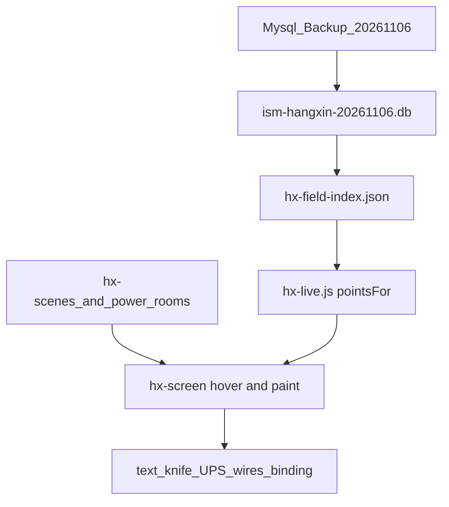

# 配电室画面问题：恢复正式库 + 整理后逐项修

## 画图技能（执行前强制）

用户已更新 CAD 读图/画图技能，**画一次图、CAD 原图、缺线核对必须走新技能**，不能沿用仓库里过期副本凭记忆画。

| 入口 | 位置 | 作用 |
|---|---|---|
| `cad-read-draw` | 用户 Store 有；**仓库 `.cursor/skills/` 目前缺失** | 总入口：只按 DWG/DXF 实体；缺线/铭牌/交叉三类改法 |
| `ism-hx-power-oneline` | 用户 Store **新于** 仓库副本（MD5 不同） | 一次图 + CAD 原图按实体生成与整片核对 |
| `ism-hangxin-knife-switch` | 用户 Store **新于** 仓库副本 | 刀闸红合绿分、刀形 |

**执行第一步**：把用户 Store 的 `cad-read-draw`、`ism-hx-power-oneline`、`ism-hangxin-knife-switch`（含 `references/绘图方法.txt`）同步进 [`.cursor/skills/`](.cursor/skills/)；两边冲突以**更新更晚且用户确认过的 Store 版**为准。之后每间改图前先读这三份。

**核对标准（新技能「同类错误」）**：缺线整片对；线和铭牌无缝不穿框；交叉接通/跳开按 CAD。CAD 有才画，画面多而 CAD 无的删。截图只辅助定位，不当底稿。修好一处当场记错法/改法。

**本计划 P4（5A1/5A2）、P6（二层四室）及任何一次图/CAD 原图改动，均按上述技能验收。**

## 问题来源（部署后新反馈）

- 文档：[docs/配电室画面问题.docx](docs/配电室画面问题.docx)（12 张截图已解到 `.tmp-docx-issues-20261106/`）
- 备份：[docs/data_dbbackup_Mysql_Backup_2026-11-06_15-04-18.zip](docs/data_dbbackup_Mysql_Backup_2026-11-06_15-04-18.zip)（内含约 611MB 的 `Mysql_Backup_2026-11-06_15-04-18.sql`）
- 二层 CAD：[docs/CAD图2层.zip](docs/CAD图2层.zip)（`2A1.dwg` / `2A2.dwg` / `2B1.dwg` / `2B2.dwg`，另有同名 `.bak`）

正文五项（编号跳过 3，自称通病、先改五层）：

1. **文字显示不对 / 不全**（image1：旁路等标签挤在一起或截断）
2. **分合闸与画面不符**（image2：`配电室5A1_T1_413_1 开关状态=0` 应分闸；下端线路应按闸状态合红/分绿；**UPS 未绑数据**）
4. **5A1、5A2 仍缺一段线**（image4 / image5 红框空档）
5. **五层除 5A1 外测点未绑上**（image6–8：5A2/5A3/5A4 悬停「这一回路还没有测点」）

上包已修「末尾 `_` + 5A4/5B4 CAD/一次图」；现场 14:32 截图仍大量未绑点，说明 key 体系 / 索引与正式库还有缺口，要用这份新备份对齐后再改。

## 本机恢复方式（默认）

当前 [ism_server_user/conf/app.conf](ism_server_user/conf/app.conf) 为 **`dbtype=1`（SQLite）**，不能直接 `DbRestore` MySQL dump。沿用已有航信预览路径，**不覆盖** `ism.db`、不串寻智：

1. 扩展 [scripts/hangxin_field_sqlite.py](scripts/hangxin_field_sqlite.py)：`HANGXIN_SQL_ZIP` 指向本次 zip；输出改为 `ism_server_user/data/db/ism-hangxin-20261106.db`，并重建 `ism-front-end-v2/public/hx-dcim/data/hx-field-index.json`
2. 在 `app.conf` 增加 `sqlitepath = data/db/ism-hangxin-20261106.db`（[db.go](ism_server_user/models/db.go) 已支持）
3. 重启本机 `ism_server`，登录校验；前端 `#/hx-dcim` 用新索引对照正式测点名

不走 OceanBase 整库导入（本机未以 `dbtype=4` 跑航信），避免拖垮现有 SQLite 开发库。

## 先交付：问题清单文档

写入仓库（计划存放约定）：

- [docs/ISM-配电室画面问题清单-20261106.md](docs/ISM-配电室画面问题清单-20261106.md)
- [.cursor/plans/ism-配电室画面问题清单-20261106.plan.md](.cursor/plans/ism-配电室画面问题清单-20261106.plan.md)

清单按「现象 → 截图 → 涉及室/回路 → 根因假设 → 改动面 → 验收」列项，标明五层优先、其他楼层后核。

## 根因初判（恢复库后用索引核实）

### P1 文字（已定方案）

现场规则（`ism-hx-power-oneline`「文字字号」）已踩过坑：**禁止为装字去改铭牌框宽/高**（拉框会把图挤乱）。

| 做法 | 结论 |
|---|---|
| 加宽/加高方框 | **不做** |
| 缩小字号 + 必要时换行，字落在原框内 | **主方案** |
| 显示截断、悬停看全文 | **不做**（监控大屏要一眼可读，不靠悬停补文字） |

另查「显示不对」是否把多条铭牌拼成一条（image1 旁路区）；那是布局/拆行问题，不是单纯字号。

### P2 分合闸 + 下端出线色（已定规则）

现场口径（金样：`配电室5A1_T1_413_1`，悬停「开关状态 = 0」）：

| 开关状态 | 刀闸画面 | 该闸下端输出线 |
|---|---|---|
| **0** | **分闸**：绿刀、斜刀片、竖线在铰接处断开 | **绿**（无电） |
| **1** | **合闸**：红刀、竖线贯通、无斜刀片 | **红**（有电） |

现状代码：

- 刀色逻辑在 [hx-screen.js](ism-front-end-v2/public/hx-dcim/js/hx-screen.js) `paint`：无 `n.op` 时 `closed = (value == 1)`，**语义已是 1 合 / 0 分**；若状态 0 仍见合闸，要排查：是否读错测点/`n.p`、双帧刀只留了合闸帧、`is-closed` CSS、或把**仍为红的下端线**误当成合闸。
- 线色在 [hx-draw.js](ism-front-end-v2/public/hx-dcim/js/hx-draw.js) `lineColor`：**写死** UPS 相关绿、其余馈线红，**不读闸状态**——这是「分闸了下端还是红」的直接原因。

实现要点：

1. 用新库核对金样刀：`nodeValue` 实值、DOM 上 `is-open`/`is-closed`、刀形是否斜刀。
2. 刀态不对则修绑点/取数/双帧挑选；**不反转**「1=合、0=分」总规则。
3. `lineColor` / `paint`：刀**下端输出线**跟随该刀开合（合红分绿）；母线、进线上游线不跟单刀乱跳。拓扑用刀出线端几何或 layout 里的 outlet 关联。
4. 更新 `ism-hangxin-knife-switch`：删除「馈线不跟开关」旧说，改为「下端输出线跟闸；母线/上游另论」。

### P3 UPS 设备识别 + 绑数据（已定口径）

现场金样（docx image3 红框）：**`500kVA 5A1-U11`** —— 这是一台 **UPS 设备**，不是普通馈线柜号。画面要能 **识别设备类型为 UPS**，并绑上该 UPS 对应测点；点/悬停要有数据。

口径：

1. **设备识别**：`5A1-U11` / `5A1_U11`、以及同型 `U12–U14`、`U21–U24`（与「500kVA」铭牌成组）按 **UPS 机组** 识别，不能当普通文字或未分类回路。
2. **有数据**：识别为 UPS 后，悬停/点选列出该设备正式库测点（电压、电流、功率、开关状态等），禁止「这一回路还没有测点」或点了没反应。
3. 同样适用于文案里带 UPS 的标签（进线/出线/维修旁路/XBP 总屏等），与机组铭牌同一套绑定规则。

现状（5A1 scene 抽样）：

- 画面只有纯文字 `5A1_U11` / `5A1-U11`，**无 `k`/`p`/`dev`，也无设备类型标记** → 前端无法当作 UPS 设备去取数。
- 另有 18 条 `UPS1进线` 等文字同样无 key。
- 附近刀有 `配电室5A1_U1_…`、`U1_XBP_` 等回路 key，与「U11 机组」铭牌未挂上。

实现要点（恢复新库索引后做）：

1. 在正式库里查 `5A1-U11` / `配电室5A1_U11` / 设备名含 UPS·U11 的 `device_real_data` / `monitor_list`，确认设备 uuid 与测点集。
2. 布局/场景节点为 U11 类铭牌补上：**设备类型（UPS）** + 可查的 `k` 或 `dev`（对齐正式设备名）；悬停走 `pointsFor` / 按设备聚合。
3. 识别规则（五层通用）：柜号匹配 `U1[1-4]`/`U2[1-4]` 且与 500kVA 铭牌同组，或文案含 UPS/XBP/旁路 → 归 UPS；金样先打通 **5A1-U11**，再扩 U12–U14、U21–U24 与其它室。
4. 与 P2 分流：P3 管 **认出 UPS + 有测点**；出线红绿仍跟对应闸（P2）。

### P4 5A1/5A2 缺线（已定铁律：按 CAD 源文件，禁止靠截图）

现场反馈 image4/5 红框空档；技能已记过：**5A1 的 500kVA（U11–U14、U21–U24）下方竖线曾经漏画**，且「以前解决过」。本次必须先回答 **为何又回退**，再按源文件补，禁止再犯「对着截图猜缺线」。

**看图铁律**（与 `ism-hx-power-oneline`「看图与接线核对」一致）：

- 一次图、CAD 原图 **只根据 CAD 文件（DWG/DXF）实体里的线和字** 生成与验收。
- **截图、缩小整图、看图软件当前画面只能作辅助定位**（告诉红框大概在哪），**不能当底稿**；缩小会藏细线，按截图画必残。
- 核对清单：是否 **缺线、缺设备、线未接到刀/变压器、线穿符号**；横竖线按该室 CAD **逐段**对。
- 源文件优先：`docs/refs/hangxin-screen-drawings/` 下该室已入库 DWG（5A1 新图 / `floor5-20261030/` 等），用 DXF 实体或现有 `cad_dxf` / 生成脚本出网表，再对照 `hx-*-layout` / `hx-power-rooms` / `cad/*.svg`。

**回退排查（动手补线前）**：

1. 对比 git：当前 `hx-5a1-layout` / `data/hx-5a1-cad-layout.json` / 5A2 对应布局与「缺线已修」提交是否被覆盖、是否打包了旧 dist、现场是否未换到含补线的包。
2. 用 DWG/DXF 实体列出红框区域应有线段 ↔ 一次图/CAD 原图实际线段，列出 **缺失/断开** 清单（有坐标，不靠目测截图）。
3. 只补清单中的缺段/缺设备/未接通；**不整室重画** 2026-11-02 已认可几何；5A2 同流程。

验收：该区域 CAD 实体有的线，一次图与 CAD 原图都在且接到设备；截图仅用于指认「修的是哪一块」。

### P5 全部配电室一次图必须绑点（根因已定位）

口径：**每一间配电室一次图的刀/回路都要能绑上正式测点**；现场「除了唯一（5A1）之外都没有」必须查清并修通，不是只修五层几间。

**已定位主因（代码/数据，恢复库后做覆盖率复核）：**

| 类型 | 室 | 绑点从哪来 |
|---|---|---|
| `hx-scenes.json` 里有 power 页且刀带 `k` | **仅 3A1、3A2、4B1、5A1** | 场景导出的 `配电室*_T1_413_1` 等 |
| `HXRooms` 列表生成的 `cad-*` 页 | 其余约 27 间（含 **5A2/5A3/5A4/5B\***、**2A1…**、1 层等） | [hx-power-room-layout.js](ism-front-end-v2/public/hx-dcim/js/hx-power-room-layout.js) 用 CAD `cad` 去 **scene 刀** 上抄 `k`/`p`；这些页 **没有 scene 刀** → `src` 空 → 刀只有几何 **没有回路名** → 悬停「这一回路还没有测点」 |

另：即便有 `k`，尾下划线/设备名不一致仍会导致空列表（上包已部分修）；power-room JSON 里刀字段只有 `cad`（如 `5A4-413-8`），**从未写出** `配电室5A4_…` 级正式名。

**修法：**

1. 新库建全室覆盖率表：每室刀数 vs `pointsFor` 非空数。
2. 在 layout 生成或 `knifeNode` 路径写入正式 `k`/`p`：`cad`（如 `T1-411-1` / `5A4-413-8`）→ `配电室{室}_{…}`，与 `device_real_data` 对齐；抄不到 scene 时 **禁止静默无 key**。
3. 缓存版本 bump；五层先验收，再扫 1～4 层与 ECC（同一套规则，不靠「碰巧有 scene」）。

### P6 二层单室 CAD → 一次图 + CAD 原图（新范围）

来源：[docs/CAD图2层.zip](docs/CAD图2层.zip) → **2A1、2A2、2B1、2B2** 四张单室 DWG（现索引里已有旧 `2A*.json`，刀数约 102/111，来自旧总图链路，**须按新单室 DWG 实体重出**）。

流程（对齐 3/4 层 / 5A4 做法，铁律同 P4）：

1. 解压入库：`docs/refs/hangxin-screen-drawings/floor2-20261106/`（只收 `.dwg`，`.bak` 可留档不参与生成）。
2. `dwg2dxf` → 用现有 `cad_room_svg.py` / `build_floor34_oneline.py`（或等价二层入口）**按 DXF 实体**生成：
   - CAD 原图：`public/hx-dcim/cad/2A1.svg` … `2B2.svg`
   - 一次图：`data/hx-power-rooms/2A1.json` … `2B2.json` + 更新 `index.json` 刀数
3. 柜号/刀块识别、进线接通、文字字号按 CAD 组码；**禁止截图描图**。
4. 套用 **P5** 写出可绑的 `k`；本机打开二层四室验收一次图 + CAD 原图 + 悬停有数。

## 逐项修复顺序

0. **同步新 CAD 技能到仓库**（`cad-read-draw` + 更新后的 oneline / knife）
1. 恢复库 + 重建索引 + sqlitepath
2. 出问题清单文档
3. **P5** 全配电室绑点根因修复（先五层覆盖率，规则通到全室）
4. **P2** 刀态 + 下端出线跟闸着色
5. **P3** UPS 设备识别 + 绑点（金样 5A1-U11）
6. **P1** 红框文字（缩字号 + 换行）
7. **P4** 5A1/5A2：按新技能整片对照 CAD 实体（缺线 / 铭牌接线 / 交叉），先查回退
8. **P6** 二层四室：读新技能 → DWG 实体 → 一次图 + CAD 原图 → 三类错误核对 + 绑点
9. 本机按技能验收 → 再打现场包

## 明确不做

- 不覆盖 `ism.db`，不灌寻智库
- 不把 `app.conf` / 预览库打进现场包
- 不整室重画 2026-11-02 已认可的 5A1/5A2/5A3/5B1/5B2/5B3（P4 只按实体补缺；P6 只重画二层四室）
- 不借二层任务去整层重画 3/4 层（3/4 仅随 P5 补 key，除非实体核对证明缺线）
- 不用仓库里过期的 oneline/knife 副本画图；不用截图当底稿
- P1：不为装字拉宽/拉高铭牌框；不做「截断 + 悬停看全文」
- P2：不把 0/1 语义改成反的；上端母线不简单跟单刀整段变色
- P4/P6：**禁止**以截图为底稿；只按 DWG/DXF 实体画一次图与 CAD 原图；画完按缺线/铭牌/交叉三类整片核对
