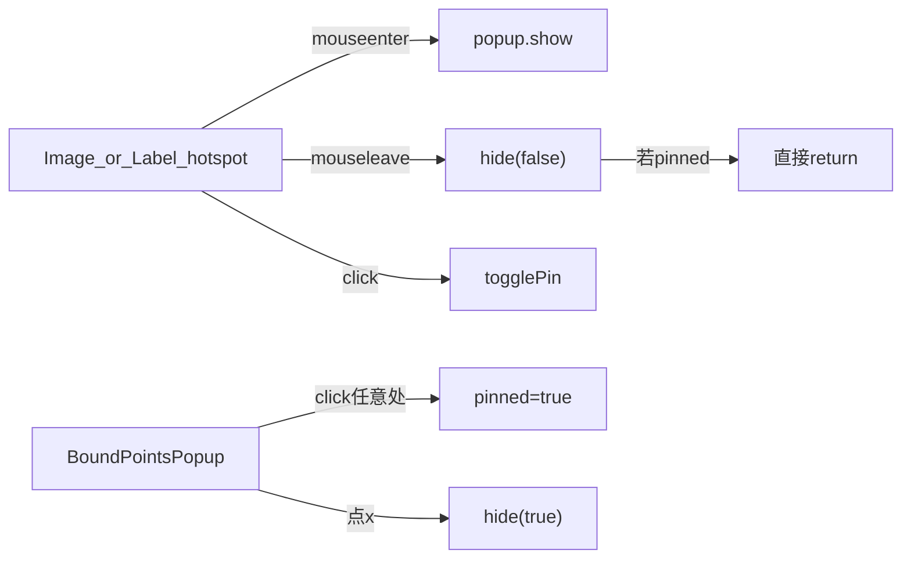

# 20261014 界面问题 1/2：测点弹窗关闭 + 文本标签弹窗

## 问题对照（文档编号）

文档实际编号为 1、3、4；你说的「1 和 2」对应两条**界面**项（历史第 4 条仍按文档先放）：

| 优先 | 现象 | 截图 |
|---|---|---|
| 1 | 小窗口可钉住，但关不掉；鼠标移开仍在 | 运行态绿色卡片「东塔办公网 U电仪表」（实时数据 / 历史曲线 / 设备档案） |
| 2（文档写作 3） | 给文本「标签」也加上同样的弹窗 | 编辑器工具箱「标签」 |

第 4 条历史查不出：仍是 TDengine `SELECT *` 10 列 vs Scan 9 列，本轮不做。

## 根因（第一性）

现场绿色卡片来自 hotfix 分支的 [`BoundPointsPopup.vue`](/tmp/ism-hotfix-field/ism-front-end-v2/src/pages/ISMDisPlay/BoundPointsPopup.vue)（经 [`boundPointsHost.js`](/tmp/ism-hotfix-field/ism-front-end-v2/src/pages/ISMDisPlay/mixins/boundPointsHost.js) 单例挂 `document.body`），不是 main 上那份青色简版。

问题 1 的直接原因：

- `hide(false)` 在 `pinned` 时直接 return → 移开鼠标不关（钉住后符合设计，但关闭路径不硬）。
- `onCardClick` 只把 `pinned` 设为 true，标题「已钉住」再点不会解除。
- 关闭依赖 `hide(true)` 的 `setTimeout(0)`，没有同步清状态；关闭按钮与卡片整卡点击抢事件时，体感就是「关不掉」。

问题 2 的直接原因：

- 弹窗 mixin 只挂在 [`ViewSvgImage.vue`](/tmp/ism-hotfix-field/ism-front-end-v2/src/pages/ISMDisPlay/ISMComponents/standard/ViewSvgImage.vue) / [`ViewPngImage.vue`](/tmp/ism-hotfix-field/ism-front-end-v2/src/pages/ISMDisPlay/ISMComponents/Images/ViewPngImage.vue)。
- [`ViewSvgText.vue`](ism-front-end-v2/src/pages/ISMDisPlay/ISMComponents/standard/ViewSvgText.vue)（工具箱「标签」）已有 `dataBind:[]`，但未接 mixin；属性面板 [`isImageHotspotComponent`](/tmp/ism-hotfix-field/ism-front-end-v2/src/pages/ISMDisPlay/ISMProperties.vue) 只对 image 类型开放测点绑定 UI。

## 基线与改动范围

- **基线**：`origin/cursor/fix-scada-nav-and-point-popup-64b6`（含已发 `2c1cd496` + 项目 ID 拦截器修复），在 `/tmp/ism-hotfix-field` 上继续改。
- **禁止**用 main 的简版 `BoundPointsPopup` 覆盖现场；**本轮不改** `ism_server`、历史 Scan、告警确认。
- `ViewSvgText` 属防回归保护区：只加弹窗挂钩与属性入口，不改 `onTextClick` 导航/分页语义。

## 方案

### 1. 卡片关闭（必做）

改 hotfix 的 [`BoundPointsPopup.vue`](/tmp/ism-hotfix-field/ism-front-end-v2/src/pages/ISMDisPlay/BoundPointsPopup.vue)：

- 新增同步 `closeNow()`：立刻 `pinned=false`、`visible=false`、清 timer、清 `currentKey`；`×` 按钮只调它。
- 标题区：未钉住显示「点击钉住」→ 点击 `pinned=true`；已钉住显示「点击关闭」→ 点击 `closeNow()`（解决「只能钉不能解」）。
- `onLeave`：未钉住仍走延迟 `hide(false)`；钉住时保持不关（用 `×` /「点击关闭」关）。
- 增加 `Esc` 与钉住后点击卡片外关闭（document capture，避免关不掉）。
- `hide(true)` 改为走 `closeNow()`，去掉「只靠 setTimeout(0)」的脆弱路径。

验收：悬停出卡 → 移开消失；点击钉住 → 移开仍在；点 `×` 或「点击关闭」或 Esc → 立刻消失，可再次悬停打开。

### 2. 文本标签同款弹窗（必做）

- [`ISMProperties.vue`](/tmp/ism-hotfix-field/ism-front-end-v2/src/pages/ISMDisPlay/ISMProperties.vue)：`isImageHotspotComponent` 增加 `view-svg-text`（必要时含 `ism-view-svg-text`），让标签属性里出现与图像相同的「绑定测点」列表。
- [`ViewSvgText.vue`](ism-front-end-v2/src/pages/ISMDisPlay/ISMComponents/standard/ViewSvgText.vue)（hotfix 副本）：
  - 引入 `imageBoundPointsMixin`（复用 `getBoundPointsPopup` 单例，不新挂一张卡）。
  - 根节点补 `@mouseenter/leave`；`boundPointList` 优先 `detail.dataBind`，若空则从已有 `animate.condition` / `active[].condition` 合成一条（兼容只绑了动画条件的旧标签）。
  - 与 `onTextClick` 共存：分页/返回/总览角色不弹窗；有 `click→link` 时点击仍走跳转，不 `togglePin`；无链接时点击才钉住。悬停出卡不受影响。

验收：标签绑测点后，运行态悬停/钉住行为与图像热点一致；带跳转的标签点击仍跳页。

### 3. 发包

- 在 hotfix worktree 生产构建，只打 `index.html + static/js + static/css` 覆盖包（与昨日完整前端包同形态）。
- 发「循安科技 SCADA 研发」@庞云泽；发前核群；说明只换前端、Ctrl+F5、历史仍下个包。

## 明确不做

- 历史查询 Scan 10 vs 9、日志洪水治理（可另开后台包）。
- 告警确认延迟。
- 回退或重发 4KB 注入脚本。
