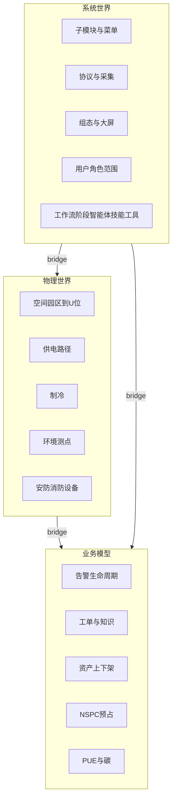

# ISM 三层世界模型与智能体方案

目标不是先做一条告警智能体，而是把这套 DCM（机房动环）**分析透**：物理世界、业务与工作流、软件系统本身，三层都进同一套本体。做法对齐 IP Agent：类型、关系、公理、动作、函数、界面写在 schema 里；实例编译成图；人通过白名单动作写回；智能体只提议。不移植 [ipagent](file:///Users/yunfanleo/cursorProjects/ipagent) 的 Python / Vue 3。栈仍是 Beego + GORM + Vue 2，库仍是 SQLite 或 OceanBase。

范围以 [docs/ISM-寻智机房环境监测-增量架构契约.md](docs/ISM-寻智机房环境监测-增量架构契约.md) 的同窗建设内容为准：监测、告警、资产 U 位、NSPC、工单知识库、能耗 PUE/碳、可视化、安防消防、权限与南北向。契约里标了 Mock 的能力，模型里照样有实体，编译时标成熟度，不假装已经落库。

正文在本文与 [.cursor/plans/ism-本体论与智能体.plan.md](.cursor/plans/ism-本体论与智能体.plan.md)。可执行类型定义在 `ism_server_user/ontology/physical_v1.yaml`、`business_v1.yaml`、`system_v1.yaml`。实体来源与成熟度见文末对照表。

## 三层怎么分

IP Agent 把「本案图」和「系统本体图」分开，层用 `case / domain / bridge`。这里对应三层，外加桥：

- **物理世界**：机房里真实存在的空间、供配电、制冷、环境、安防消防设备和测点。不依赖某张页面在不在。
- **业务模型**：人怎么处置这些对象。状态机和工作流是实体，不是页面上的按钮说明。
- **系统世界**：DCM 软件自己。子模块、菜单、协议驱动、采集、组态、权限，以及将来的智能体五元。对齐 IP Agent 的 [docs/ontology-ai-entities.md](file:///Users/yunfanleo/cursorProjects/ipagent/docs/ontology-ai-entities.md)。
- **桥**：系统怎样看见物理对象，业务怎样挂到物理对象上。例如页面展示机房、采集通道采样测点、工单跟踪告警、告警由设备产生。

两张图，和 IP Agent 的案件图 / 系统图一样：

- **系统图**：一次部署一份。来源是代码注册表和菜单契约，不依赖现场设备。
- **世界图**：每个 `project_uuid` 一份，可再按机房 `focus_key` 收窄。装物理实例、业务实例和桥。

每个实体带 `maturity`：`live`（已有表，能编译出实例）、`mock`（只有 JSON/脚本）、`planned`（契约有、仓库还没有存储器）。`planned` 仍出现在 schema 和图的缺口里，保证模型完整，同时不把骨架写成已交付。

## 物理世界模型

空间沿 [docs/ISM-组织层与信号层钻探模型.md](docs/ISM-组织层与信号层钻探模型.md) 和资产契约「园区…机柜」：

- `Campus` 园区、`Building` 楼、`Floor` 层、`Room` 机房/模块机房、`Row` 列、`Rack` 机柜、`USlot` U 位、`MicroModule` 微模块
- 监控树里分型之前的容器先落成 `SiteNode`（`MonitorList`，`type=0`）。能按名称或扩展字段归类时，再用 `classified_as` 指到上面的类型。归类不了就留 `SiteNode`，公理标「未分型」

动力（契约：配电、UPS、蓄电池单体、列头柜）：

- `MainsIncomer` 市电进线、`Transformer`、`LvBoard` 低压配电、`ColumnHeader` 列头柜、`UPS`、`BatteryString` 电池组、`BatteryCell` 单体
- 关系 `feeds`：上游供电下游。路径不完整是公理，不是隐藏字段

制冷与环境：

- `PrecisionAC` 精密空调、`CDU`
- `TempHumidityPoint`、`LeakPoint` 漏水、`HydrogenPoint` 氢气
- 通用 `Point`：一条 `DeviceRealData`。专用类型用 `classified_as` 从点名/物模型提升，提升失败仍保留 `Point`
- `cools`：空调/CDU → `Room` 或 `Rack`
- `measures`：测点 → 设备或空间

安防消防设备（物理对象，事件在业务层）：

- `Camera`、`Door`、`IntrusionPoint`、`FireDetector`、`AVAlarm` 声光

IT 与网络占位：

- `ITAsset` 占用 `USlot`（`occupies`，可跨连续 U）
- `NetworkEndpoint`：NSPC 的 N。没有独立台账时先作为容量维度上的逻辑对象，`maturity=planned`

设备实例：

- `Device`：监控树设备节点（`MonitorList.type=1`），带协议种类。虚拟设备（测点名最后一个 `_` 前缀，不入库）编成 `VirtualDevice`，`part_of` 真设备。这条规则已在钻探模型里，编译器必须遵守，不能把虚拟柜写回 `monitor_list`

## 业务模型

业务对象和状态机按契约子模块列全。状态是实体属性，流转是关系或动作，不写死在某个页面里。

告警 `envmon-alarm`（`live`：`AlarmTrigger`、`DevicesAlarmList`）：

- `AlarmPolicy` 触发策略、`Alarm` 活动/历史、`NotifyAttempt` 屏/语音/声光
- 状态：`active` → `acked` → `cleared`。确认不改采集、不触发联动下发

工单与知识 `dcim-workorder`（`mock`：`data/xunzhi-jf/dcim_workorder_store.json`）：

- `WorkOrder`：`open` → `in_progress` → `archived`
- `WorkOrderEvent` 流转记录、`KnowledgeItem` 归档沉淀（`planned`，骨架文档写明还没有知识库）
- `tracks`：工单 → 告警

资产生命周期 `dcim-asset`（`mock`：U 位 JSON；正式表 `dcim_asset` / `dcim_rack_u` 为 `planned`）：

- `AssetTicket`：`inbound` 入库、`mount` 上架、`change` 变更、`unmount` 下架、`retire` 报废
- `binds`：票据 → `ITAsset` + `USlot`

容量 NSPC `dcim-capacity`（`mock`：空间 S + 供电 P；网络 N、制冷 C 为 `planned`）：

- `CapacityAccount` 四个维度 N/S/P/C，属性 total / used / reserved / free
- `Reservation` 预占、`PlacementAdvice` 推荐上架（`planned`）
- `accounts_for`：容量账 → `Room` 或 `Rack`

能耗 `dcim-energy`（`mock`：单机房功耗、手工补录、PUE、碳因子样例）：

- `EnergyLedger` 分项功率、`ManualEnergyEntry`、`PueSnapshot`（facility / it）、`CarbonFactor`、`CarbonSnapshot`
- `of_room`：账本 → `Room`

安防消防事件（`mock` 桩）：

- `AccessEvent`、`IntrusionEvent`、`FireEvent`、`LinkageState`
- `about`：事件 → 物理设备。联动状态只记录，本方案不自动下发控制

远程控制是业务过程，不是智能体能力：

- `ControlRequest`：申请 → 二次确认 → 执行。执行仍走现有 `/setData`。智能体与本体动作都不得创建或批准它

报表：

- `ReportDefinition`、`ReportRun`（`planned`，菜单里有报表中心）

每条工作流在系统层登记为 `Workflow`，阶段是 `Phase`。第一版就要登记下面七条，哪怕运行器后做：

- `alarm_lifecycle`：产生 → 通知 → 确认 → 可选转工单 → 清除
- `workorder_close`：由告警建单 → 派单 → 处理 → 确认 → 归档 → 知识
- `asset_lifecycle`：入库 → 上架占 U → 变更 → 下架 → 报废
- `capacity_reserve`：水位快照 → 预占 → 推荐上架 → 释放
- `energy_pue`：汇功率 → 手工补录 → 算 PUE → 算碳
- `security_fire_ingest`：事件入列 → 展示 → 联动状态
- `remote_control`：申请 → 二次确认 → 写测点（人）

## 系统世界模型

来源是契约 §2 子模块和 [docs/机房环境监测-菜单树与路由权限挂点.md](docs/机房环境监测-菜单树与路由权限挂点.md)，加上现有协议代码。系统图不读现场库也能编出来。

子模块（`Module`）：`envmon-collect`、`envmon-alarm`、`envmon-viz`、`dcim-asset`、`dcim-capacity`、`dcim-workorder`、`dcim-energy`、`envmon-iam`、`envmon-south`、`envmon-north`。

菜单与页面：契约菜单树上每个 `code`（`jf.monitor.power`、`jf.asset.u`、`jf.workorder.kb` 等）一个 `Page`。`Module` —`exposes`→ `Page`。路由未挂上的页面，公理标「有契约无入口」。

采集与协议（`live`，在 `ism_server_user/protocol` 与各 DeviceModel）：

- `ProtocolDriver`：Modbus、SNMP、OPC UA、BACnet、IEC104、IEC61850、DLT645、CJT188、MQTT、HJ212、REST
- `SouthChannel` 绑 `Device`，`NorthInterface` 为向上级环境监测的预留（`planned`）
- `RealtimeBus`、`HistoryStore`：实时通道与历史库，作为系统对象被页面和测点引用
- `CollectorTask`：设备采集周期、超时、失败次数，属性来自 `MonitorList`

组态：`DisplayModel`、`DisplayPage`、`DisplayComponent`。`renders` 桥到 `Room` / `Device` / `Point`。2.5D 导航是 `Page`，成熟度按现有壳标 `mock`，不另造一套空间实体。

身份：`User`、`Role`、`Permission`、`DataScope`。权限码沿用菜单文档，不新造一套角色名。`can_access`：角色 → 模块/页面。

智能体五元写进系统本体，和 IP Agent 一样是可浏览对象，不是隐藏提示词：

- `Workflow`、`Phase`、`Agent`、`Skill`、`Tool`
- 关系：`has_phase`、`has_step`、`uses_skill`、`exposes_tool`
- 上面七条业务工作流各有阶段；智能体只允许挂在阶段上。工具白名单默认只读（读图、读测点、读公理）。写操作不是工具，是人点的 Action

## 桥与公理

桥关系（schema 层 `bridge`，两端类型必须在白名单里）：

- 物理内部：`contains`、`feeds`、`cools`、`measures`、`part_of`、`occupies`、`classified_as`
- 业务到物理：`raised_by`、`about_point`、`tracks`、`binds`、`accounts_for`、`of_room`、`about`
- 系统到世界：`samples`（通道→测点）、`renders`（组态→对象）、`exposes`（模块→页面）、`guards`（权限→页面）

公理按层检查，命中进 `gap` 视图。第一版至少这些：

- 空间：设备没有 `contains` 父节点；`USlot` 被两个 `occupies` 重叠
- 动力：`UPS` 或列头柜没有 `feeds` 上游
- 告警：活动告警没有 `raised_by`；`about_point` 的测点不属于该设备
- 告警处置：活动超过配置时长，没有确认 Decision，也没有未归档工单
- 工单：工单没有 `tracks`；同一告警两条未归档工单
- 容量：预占使 free 小于 0；N/C 维度在契约中存在但无账本（`planned` 缺口，warning）
- 能耗：PUE 的 it 功率为 0 或缺失
- 系统：菜单契约有 `Page` 但路由未注册；模块没有任何 `Page`
- 智能体：写类建议若指向 `ControlRequest` 或 `/setData`，直接 error，不进隔离区

隔离区只放智能体写出的、尚未 `VerifyEdge` 的假设边（根因、推荐上架）。编译器写出的确定性边不进隔离区。

## 动作目录

动作在 schema 里按七条工作流列全，每条带 `implemented: true|false`。未实现的动作 API 返回明确的「模型已定义、写路径未落地」，并在系统图弱项里可见。第一版真正执行的只有已有写路径：

- `VerifyEdge`：确认或软删桥边或假设边，记 `Decision`
- `AckAlarm`：记确认，不改触发器和联动
- `CreateWorkOrder` / `TransitWorkOrder`：走现有寻智工单 JSON
- `MountAsset` / `UnmountAsset`：走现有 U 位 JSON（连续 U、禁止重叠）
- `ReserveCapacity`：走现有容量 JSON（仅 S/P）
- `AddManualEnergy`：走现有能耗 JSON，并重算该机房 `PueSnapshot`

`ApproveControl` 在目录里，`implemented: false`，并且 `allowed_interfaces` 排除一切智能体界面。

## 编译器与存储

不另建一套设备主数据。`node_key` 稳定：`Device:{uuid}`、`Alarm:{id}`、`Page:jf.asset.u`、`Module:dcim-energy`。人锁住的节点编译器不覆盖。

世界图编译器读：

- `live`：`MonitorList`、`DeviceRealData`、`DevicesAlarmList`、`AlarmTrigger`、用户角色与现有路由能对上的页面
- `mock`：[ism_server_user/models/xunzhiJfWorkorder.go](ism_server_user/models/xunzhiJfWorkorder.go) 及资产、容量、能耗的 `data/xunzhi-jf/*.json`
- `planned`：不造假实例。schema 里保留类型；若契约要求该机房应有而存储器没有，gap 里放一个类型级缺口节点（例如「本项目无制冷容量账本」）

系统图编译器读 Go 注册表：模块清单、菜单码、协议驱动列表、工作流定义。部署后即可浏览，没有寻智项目也能打开。

表：`ont_node`、`ont_edge`、`ont_decision`，加 `graph_kind`（`system` | `world`）和 `layer`。技能与运行记录表 `agent_skill`、`agent_run`、`agent_run_step` 在智能体运行器那一期再迁，避免模型还没浏览就先做对话。

接口挂 [ism_server_user/routers/router.go](ism_server_user/routers/router.go)，沿用登录中间件：

- `GET /ontology/schema?layer=physical|business|system|bridge`
- `POST /ontology/compile`：`graph_kind`、`project_uuid`、可选 `focus_key`
- `GET /ontology/graph`：视图 `physical`、`business`、`system`、`bridge`、`gap`、`quarantine`
- `GET /ontology/lint`
- `POST /ontology/actions/:actionId`

代码新包：`ism_server_user/ontology/`（三份 yaml、schema、compiler、axiom、action、graph）。控制器 `ontologyCtl.go`。不改采集热路径、密码链路、组态组件注册和 `actions.js`。

## 界面与智能体的位置

本体中心（Vue 2，挂现有路由）：左侧三层图例，中间图，右侧公理和动作。系统图不选项目也能看。世界图要选 `project_uuid`，可再选机房。五视图对应上面的 layer。图用现有前端能画的分层 SVG，不搬 IP Agent 星图。

智能体是系统层的五元，运行器排在模型可浏览之后：

- 目录先编译进系统图，让人看见哪条工作流将由哪个 `Agent` 负责、哪条 `Skill` 约束输出
- 第一个可运行的工作流仍是 `alarm_lifecycle` 上的只读分析（读图、标假设、建议开单），因为告警数据是 `live`。建议不执行动作
- 未配置模型时，确定性编译和公理照常完成，模型步骤标 skipped
- 资产、容量、能耗、安防的智能体只在对应编译器有实例之后再挂，避免对空模型说话

## 分期

1. 方案入库，并写出三份 schema 与「实体 → 代码或 JSON 来源 → maturity」对照表。这是「分析透」的交付物，评审看模型是否缺域，不看页面。
2. 内核：加载 schema、两张图、layer 过滤、公理。系统图不依赖现场数据。
3. 世界图编译器：live + mock 出实例，planned 出类型级缺口。
4. 已实现动作接到现有 JSON/告警确认；其余动作列在目录里并在弱项中可见。
5. 本体中心五视图。验收时打开寻智项目，能从机房走到设备、测点、告警、工单或 U 位，也能看到未落地的知识库、制冷容量、北向接口缺口。
6. 把七条工作流的阶段和智能体登记进系统图；只为 `alarm_lifecycle` 接运行器。模型关闭时编译仍成功，且没有任何 `/setData` 调用。

## 验收

- schema 三层都能列出。物理层含空间、动力、制冷、环境、安防设备；业务层含七条工作流的状态；系统层含十个模块和菜单码。
- 无项目数据时，系统图仍能画出模块、页面、协议、工作流。
- 有寻智项目时，世界图的 `Device` / `Alarm` 对得上 `MonitorList.uuid` 和告警主键；U 位、工单、PUE 来自现有 JSON 的标 `mock`。
- 知识库、制冷容量、北向、推荐上架在 `gap` 里是缺口，不出现伪造实例。
- 重叠 U 位、告警无设备、未挂路由的菜单码能被公理打中。
- `CreateWorkOrder` 写入现有工单存储并出现 `tracks`。`ApproveControl` 不能执行。
- 组态、登录、实时推送行为不变。

## 实体来源与成熟度对照

成熟度写在 schema 的 `maturity` 字段。编译器只在对应来源有记录时生成实例；`planned` 且契约要求出现、存储器没有时，生成 `Gap:*` 缺口节点，不编造业务实例。

| 实体 | 层 | maturity | 来源 |
|------|----|----------|------|
| SiteNode / Device / Point / Alarm / AlarmPolicy | 物理、业务 | live | `monitor_list`、`device_real_data`、`devices_alarm_list`、`alarm_trigger` |
| VirtualDevice | 物理 | live | 测点名最后一个 `_` 前缀，不写回 `monitor_list` |
| Room / UPS / ColumnHeader / PrecisionAC 等 | 物理 | live 或 planned | 由名称归类；归类前仍是 SiteNode 或 Device |
| USlot / ITAsset / WorkOrder / CapacityAccount / PueSnapshot | 业务、物理 | mock | `data/xunzhi-jf/dcim_*.json` |
| KnowledgeItem / PlacementAdvice / NorthInterface / ReportDefinition | 业务、系统 | planned | 无存储器，只出缺口节点 |
| 制冷/网络容量正式账本 | 业务 | planned | JSON 里若有 N/C 样例则另标 mock 账户，并保留「正式账本未落地」缺口 |
| Module / Page / ProtocolDriver / Workflow / Phase / Agent / Skill / Tool | 系统 | live | `ontology/catalog.go`，页面与 `menuFlat.js` 对齐 |
| User / Role | 系统 | live | `user`、`roles_list`，不读取密码字段 |
| DisplayModel | 系统、世界 | live | `display_models` |
| CollectorTask / SouthChannel | 系统 | live | 由监控树设备行编译 |
